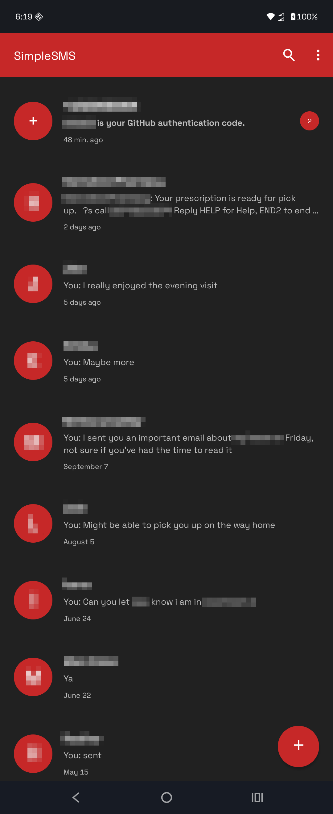
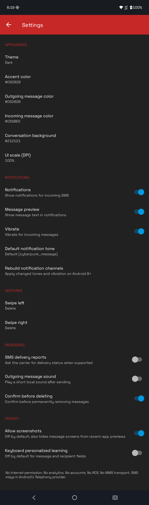

# SimpleSMS

**SMS and MMS, without the corporate surveillance carnival attached.**

SimpleSMS is a local Android messaging client built around the AOSP Messaging / Bugle-era interface. It handles conversations, contacts, notifications and carrier messages without accounts, analytics, advertising, cloud sync or an RCS service attached to it.

The aim is straightforward: keep the familiar messaging interface, add useful controls, and leave the user's data on their device wherever the carrier protocol allows. An SMS client should not need to report how often somebody opens Settings.

## What it does

| Area | Features |
| --- | --- |
| SMS | Send and receive, multipart messages, sent/failed status, optional carrier delivery reports |
| MMS | Carrier sending, manual downloads, attachments and outgoing group messages |
| Conversations | Search, archive, configurable swipe actions, read state and message locks |
| Appearance | Light/dark/system themes, accent and bubble colors, conversation backgrounds, custom hex colors and 80–150% UI scaling |
| Contact controls | Local contact lookup, per-conversation colors, mute and notification tones |
| Notifications | Optional sender/text previews, reply and confirmed delete actions, Android notification settings |
| Media | Built-in text, image, audio and video viewer; explicit external-open option |
| Private storage | Optional encrypted message storage, encrypted attachments, drafts and ordinary preferences |
| App lock | Optional device-credential gate, independent of the message-storage setting |

There is no account to create, backend to maintain, advertising SDK, analytics SDK or cloud-sync dependency. RCS, automatic MMS downloads, automatic resend scheduling and backup/export/recovery features are not implemented.

## Getting started

Install the APK and open SimpleSMS. Set it as the default SMS app for normal sending, receiving and shared-message editing, then grant the permissions needed for the features you use.

Existing Android SMS/MMS and earlier private messages appear together. You do not need to import your history just to read it, and enabling private storage does not automatically move old messages.

For attachments, use **+** in the composer. Tap a pending MMS to confirm its download, then open the downloaded message in the built-in viewer; supported formats depend on the device's codecs.

## Choose where messages are stored

**Settings → Private message storage** controls new messages and explicit MMS downloads. It is off by default, and messages already being sent or downloaded keep the storage route chosen when that operation began.

| Setting | Behavior |
| --- | --- |
| Off | New messages go into Android's shared message store, where other SMS apps can access them. Earlier private messages stay encrypted and visible in SimpleSMS. |
| On | New messages and attachments go into SimpleSMS's encrypted private store. Matching shared copies are removed only after verification and a check that the originals remain unchanged. |

Turning private storage off does not export earlier private messages. Locked, changed, ambiguous, active-send or unverified shared copies are retained; cleanup that needs an authenticated key waits until the app is unlocked.

**Private messages become SimpleSMS's responsibility.** Other SMS apps cannot read them, and uninstalling, clearing app data or losing the encryption key can permanently destroy access. There is no backup or recovery feature, so enabling the setting requires a separate warning and confirmation.

### Move existing SMS/MMS

Use **Settings → Move existing SMS/MMS** to move older shared history into encrypted storage. For each eligible message, SimpleSMS saves the encrypted copy, reads it back, authenticates its attachments, compares the contents and checks the original again before deleting it from Android's shared store.

Version 1.4.5 shows SMS/MMS progress and moved/kept counts. **Stop** finishes the current message safely; running the move again checks existing private copies and continues with remaining originals.

Keep the app open during a move. App-lock timeouts still apply, so a long import may require unlocking and starting the move again; a provider or Keystore operation already in progress cannot be interrupted by Stop.

Avoid editing shared messages in another app during migration. The shared provider and private vault cannot participate in one transaction, and deleting a shared row does not guarantee physical erasure of old flash pages, snapshots or copies held elsewhere.

## App lock and encryption

**Settings → App lock** is separate from private message storage. It defaults to off on fresh installations, while an existing protected vault keeps its lock until you change it; private data remains encrypted with app lock off.

Each private record or attachment uses a fresh random AES-256 key with AES-GCM encryption. That key is wrapped using RSA-OAEP and a device-generated Android Keystore key, rather than a secret embedded in the APK.

With app lock enabled, SimpleSMS requires hardware-enforced device authentication. It clears unlocked caches on screen-off, after 30 seconds fully in the background, after the four-minute session limit, or through **Settings → Lock now**.

Changing the app-lock setting re-encrypts existing private records and media under the new key policy. Keep the app open until it finishes; interrupted conversions retain the information needed to resume without retiring the original key prematurely.

Encryption protects stored app contents, but it does not make a compromised operating system trustworthy. Plaintext exists while messages are displayed or sent, and file sizes, record counts and other storage metadata remain observable.

## Notifications and media privacy

Sender and message previews are off by default. Enable **Show notification details** if you want them in the notification shade; Android's lock-screen settings and authorized notification listeners still determine who can see that content.

**Notification reply and delete** is on by default. With app lock off, Reply supports inline entry; with app lock on, it opens the composer through the authentication gate, while Delete asks for confirmation and respects message locks.

Locked sessions use generic notifications without action buttons. **Hide MMS content** also defaults on, concealing MMS text in conversation lists and notifications until you choose to view it.

Screenshots and recent-app captures are blocked, keyboard personalized learning is disabled by default in message fields, and Android app backup/device-transfer extraction is disabled. Copying text still puts it on Android's clipboard, and choosing **Open externally** gives the selected app temporary plaintext access that it may use to retain its own copy.

## Permissions and carrier access

The app manifest declares these permissions:

| Permission | Purpose |
| --- | --- |
| `READ_CONTACTS` | Resolve phone numbers through the local contacts provider |
| `READ_SMS` | Display existing shared message history |
| `RECEIVE_SMS` | Receive SMS as the default messaging app |
| `SEND_SMS` | Send carrier messages through Android's telephony APIs |
| `RECEIVE_MMS` | Receive carrier MMS events |
| `RECEIVE_WAP_PUSH` | Receive MMS notification pushes |
| `POST_NOTIFICATIONS` | Show notifications on Android versions requiring permission |

SimpleSMS does not request `INTERNET`. Carrier MMS transport is handled through Android's telephony services, so that absence does not mean MMS is offline or that the carrier cannot see its traffic.

SMS and MMS are **not end-to-end encrypted**. Android, the modem and the carrier handle messages outside the app's encrypted store; the privacy goal is to avoid adding an app-operated data collector to that existing chain.

## Compatibility and limits

SMS requires Android 7.0 or newer. The RAM-backed MMS transport requires Android 8.0 or newer, and the interface includes system-bar and display-cutout handling for modern Android layouts.

Outgoing MMS is limited to the carrier's configured size or 1 MiB, whichever is smaller. Downloads and individual attachment reads are bounded at 10 MiB; oversized outgoing images are resized to fit the sending limit.

Comma- or semicolon-separated recipients support outgoing group MMS, including text-only messages. Replies to incoming group MMS currently target the sender, and MMS read/delivery reports are not implemented.

MMS transfers use temporary, seekable RAM-backed descriptors instead of plaintext app transport files. Process death or an expired transfer may require a retry, and carrier/OEM compatibility still needs device testing.

## Version history

### SimpleSMS 1.4.5

- Reduce redundant conversation refreshes and avoid repeated encrypted-storage reads during normal browsing.
- Add import progress, moved/kept counts, prevention of overlapping imports and a safe Stop action.
- Preserve per-message encryption and verification before removing shared originals.

### SimpleSMS 1.4.4

Changes since 1.4.3:

- Added optional sender/message previews in notifications; details remain hidden by default.
- Added a notification-action switch, inline replies with app lock off, guarded composer
  access with app lock on, and single-message deletion with confirmation.
- Seal inline reply drafts before sending so failed submissions can be recovered.
- Keep separate notifications tied to their own messages, and replace pending MMS
  notices when downloads complete.
- Redact posted previews/actions when an enabled app lock closes the session.
- Hide MMS content by default behind “Tap to display message,” including list and
  notification text previews. Added a setting to disable MMS hiding.
- Added single-tap MMS opening and a built-in viewer for text, supported images,
  audio and video, with play/pause and seeking. Decrypted media stays in memory.
- Retained explicit external opening in the long-press menu and all existing storage,
  encryption, app-lock, migration, theme, archive, gesture and messaging features.

### SimpleSMS 1.4.3

## Message storage

- Added **Settings → Private message storage**, disabled by default.
- With private storage disabled, new incoming and outgoing SMS/MMS is saved in Android’s shared message store.
- With private storage enabled, new messages and attachments are saved directly into SimpleSMS’s encrypted private store.
- Added scoped cleanup of matching shared copies. Deletion requires verification of the persisted encrypted message and attachments, matching content, and a final check that the shared original remains unchanged.
- Locked, changed, ambiguous, active-send, or unverified shared originals are retained.
- Cleanup requiring an authenticated private key waits until the app is unlocked.
- Added a prominent red warning and confirmation explaining shared-copy deletion, exclusive management by SimpleSMS, and possible permanent loss after uninstalling, clearing app data, or losing the encryption key.
- Storage routing is retained for messages already being sent or downloaded when the setting changes.
- Disabling private storage does not export or decrypt earlier private messages.

## Existing messages

- Display existing Android SMS/MMS alongside private encrypted messages.
- Combine shared and private messages into chronological conversations.
- Read shared MMS text and attachments without requiring migration.
- Observe shared-store changes and refresh the message lists.
- Prevent collisions between private, shared SMS, and shared MMS message IDs.
- Suppress matching migrated copies while retaining changed shared messages.
- Allow browsing shared history with SMS read permission without requiring send and receive permissions.
- Keep private history accessible when shared-message read permission is unavailable.
- Show read errors and permission guidance instead of silently presenting an empty history.

## Manual migration

- Added **Move existing SMS/MMS** for explicitly converting older shared history.
- Encrypt messages and attachments, read back and authenticate the stored copies, then conditionally delete unchanged originals.
- Skip locked messages, active sends, changed originals, and failed verification.
- Recognize previously stored copies when retrying an interrupted move.
- Preserve available legacy drafts and archive settings.
- Enabling private storage alone does not migrate older history.

## Encryption and key handling

- Added private encrypted storage for message contents, addresses, timestamps, statuses, conversation metadata, attachments, drafts, and ordinary preferences.
- Use a fresh random AES-256 key for each encrypted record or attachment, protected with AES-GCM.
- Wrap individual data keys using RSA-OAEP and a device-generated Android Keystore key.
- Keep secret keys out of the APK. The encryption algorithms and format are public; security depends on the generated keys.
- Store attachments under random filenames and verify their contents against authenticated digests.
- Authenticate record identities and split large encrypted database records into smaller chunks.
- Encrypt and remove legacy plaintext app preferences on successful opening.
- Retain only non-secret startup and routing policies outside encrypted storage.
- Disable Android app backup and device-transfer extraction. No backup, export, or recovery feature is included.

## Optional app lock

- Added **Settings → App lock**, independent of private message storage.
- Default app lock to off for fresh installations.
- Preserve the existing lock when upgrading an already protected vault.
- Keep private data encrypted when app lock is disabled, without requiring an additional app credential prompt.
- Require hardware-enforced device authentication when app lock is enabled.
- Re-encrypt existing private data when changing key authentication policy.
- Support interrupted key conversions without retiring the original key before conversion commits.
- With app lock enabled, clear unlocked caches on screen-off, after 30 seconds in the background, after the four-minute session limit, or through **Lock now**.

## MMS support

- Added carrier MMS sending, incoming notifications, and manual downloads.
- Support text, image, audio, video, and outgoing group MMS.
- Support comma- or semicolon-separated recipients.
- Resize oversized images to fit carrier limits.
- Cap outgoing MMS at the carrier limit or 1 MiB, whichever is smaller.
- Bound downloaded MMS and individual attachment reads to 10 MiB.
- Handle carrier acknowledgements and deferred-download responses.
- Use temporary, seekable RAM-backed transfer descriptors instead of plaintext app transport files.
- Add MMS parser bounds checks and malformed-input handling.
- Preserve relevant read and lock state when completing downloads.
- Suppress completed messages’ duplicate pending notifications.

## Privacy and message handling

- Use generic notifications without sender identities, message text, or conversation identifiers.
- Keep notification sound and visibility controls in Android settings.
- Block screenshots and recent-app captures.
- Prevent message and recipient fields from saving their contents into ordinary saved view state.
- Store send and delivery callback information encrypted.
- Handle duplicate and out-of-order multipart status callbacks.
- Route explicit read, lock, and delete actions to the correct shared or private message.

### SimpleSMS 1.2.3

- Actual AOSP Messaging-derived UI structure retained
- SMS-only backend retained
- Network-facing functionality removed
- Internet permission removed
- RCS removed
- MMS transport removed
- Telemetry and cloud functionality absent
- Archive support added
- Configurable swipe actions added
- Per-contact notification tones added
- Per-contact mute added
- Per-conversation colors added
- Global accent/bubble/background color controls added
- UI/DPI scaling added
- Dark mode added and text inversion corrected
- SMS delivery reports added
- Outgoing send-state handling added
- Screenshot protection added
- Keyboard personalized-learning control added
- Android 15/16 edge-to-edge display fixes added
- Status/navigation-bar clearance added
- Compose button navigation-bar overlap fixed
- Conversation bottom-content overlap fixed
- Topmost message toolbar overlap fixed
- RecyclerView top clipping/clearance fixed
- Java 8 source compatibility retained
- Android 7.0 Nougat compatibility retained

---

## Licensing and attribution

Project license: [No Faults Software License](https://github.com/ZoKLav/no_fault_license). AOSP-derived components retain their applicable license notices; the source package includes [LICENSE](LICENSE), [NOTICE-AOSP](NOTICE-AOSP) and [NOTICE-MMS](NOTICE-MMS).

Read the license terms and component notices before redistributing. The older AOSP notice describes the original SMS-only fork; current releases include carrier MMS support.

## Design philosophy

Features belong here when they make messaging more useful without requiring an account, a cloud backend or a new reason to collect data. Colors, local contact controls, message organization and private storage meet that test; engagement tracking and advertising do not.

Software is allowed to do its job and then shut up. SimpleSMS should handle your messages and mind its own fucking business.

## Screenshots

  
  

